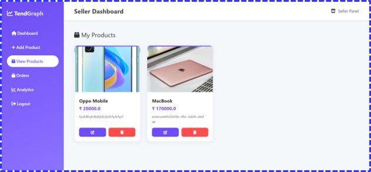
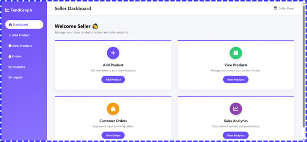
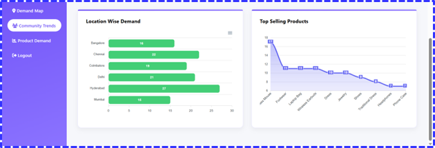
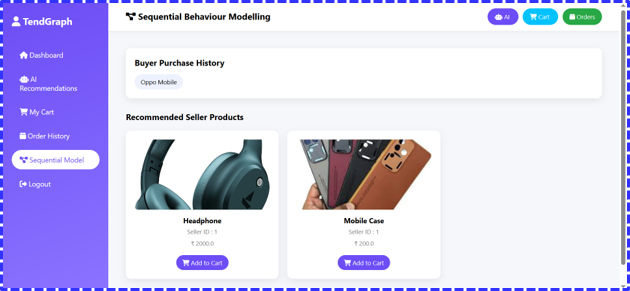

# Purchasing Tendency Prediction and Community Analysis

## About the Project

Purchasing Tendency Prediction and Community Analysis is a final-year academic project designed to explore customer purchasing behaviour in an e-commerce environment.

The project combines web application functionality, customer interaction tracking, sequential behaviour analysis, graph-based learning, product recommendations, and community analytics.

## Project Features

- Buyer and seller modules
- Admin management module
- Product browsing and shopping cart
- Order management
- Customer interaction tracking
- Purchasing behaviour analysis
- Sequential behaviour-based recommendations
- Graph-based customer behaviour analysis
- Community analytics
- Demand insights
- Location-based visualisation

## AI/ML Models

- **TendGraphNet:** Graph-based model designed to analyse relationships and behavioural patterns.
- **SeqBehNet:** Sequence-based model designed to process customer interaction patterns.

The project includes saved model weights for both models.

## Technologies Used

- Python
- Flask
- PyTorch
- PyTorch Geometric
- NumPy
- Pandas
- Scikit-learn
- HTML
- CSS
- JavaScript
- MySQL

## Project Structure

- `app.py` – Flask web application
- `model.py` – Model implementation
- `seqbehnet.pth` – Saved sequence model weights
- `tendgraphnet.pth` – Saved graph model weights
- `static/` – Images, datasets and static resources
- `templates/` – HTML templates
- `requirements.txt` – Python dependencies

## Project Type

Final-Year Academic Project
## Application Screenshots

### Home Page

### Buyer Dashboard

### Product Browsing

### Seller Dashboard

### Demand Map

### Community Trends

### Product Demand Analysis
.png)

### Sequential Model

## Disclaimer

This project was developed for academic and demonstration purposes. Sample data is used to demonstrate the application features and purchasing behaviour analysis.
